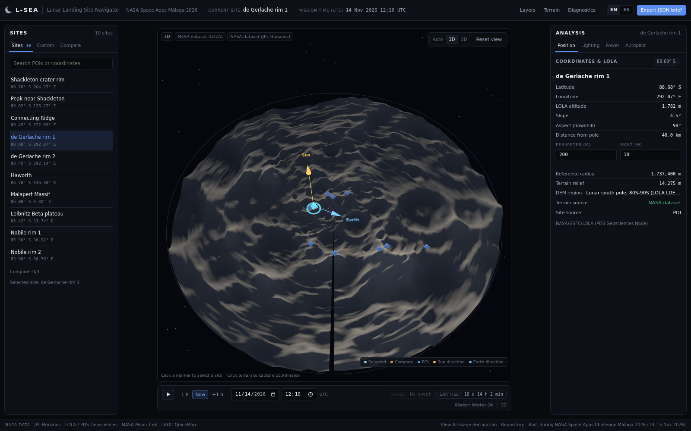

# L-SEA Space Apps

Lunar south-pole landing site navigator built for the NASA International Space
Apps Challenge, Málaga 2026.

The application lets mission planners, educators and the public compare lunar
landing sites and dates in seconds: select a site, choose a date, and see the Sun
and Earth relative to the local terrain horizon, with power and direct-to-Earth
communication windows derived from real NASA data.

[](https://github.com/rafaa-sf/l-sea-space-apps/actions/workflows/ci.yml)
[](https://rafaa-sf.github.io/l-sea-space-apps/)
[](https://vuejs.org)
[](docs/README.md)

**Live application:** <https://rafaa-sf.github.io/l-sea-space-apps>



## What it does

Landing on the Moon's south pole means trading sunlight for power, Earth
visibility for communications, and terrain that hides the horizon. The data lives
in specialist tools such as JPL Horizons, Moon Trek and LROC QuickMap; L-SEA turns
it into a single comparison workflow. At the pole the terrain, not the ephemeris
alone, decides whether the Sun or the Earth is visible, so the tool ray-traces the
local horizon from real LOLA elevation data before estimating power, links and
mission feasibility.

The canonical feature reference — what each feature does, which modules implement
it and why the design was chosen — is **[docs/features.md](docs/features.md)**.

## Entry points

- `/` — project landing page: the challenge, what the tool does, the NASA data
  behind it, impact and scalability, and the grouped documentation index.
- `/#/tool` — the interactive mission console (lazy-loaded; a `Project overview`
  link returns to the landing page).

## Documentation

Full grouped index: **[docs/README.md](docs/README.md)**. Feature reference:
**[docs/features.md](docs/features.md)**.

- **Project and challenge:** [features](docs/features.md) · [challenge](docs/challenge.md) · [architecture](docs/architecture.md) · [NASA data](docs/data.md) · [AI use declaration](docs/ai-usage.md)
- **Product, impact and submission:** [submission](docs/submission.md) · [demo](docs/demo.md) · [impact and scalability](docs/scalability.md) · [commercial case](docs/commercial.md)
- **Quality and operations:** [QA and test bench](docs/qa.md) · [UX compliance](docs/ux-compliance.md) · [deployment](docs/deployment.md) · [contributing](docs/contributing.md) · [security](docs/security.md) · [decisions](docs/decisions.md) · [Miro integration](docs/miro.md)
- **Reproducible test bench:** [qa/README.md](qa/README.md) · [qa/REPORT.md](qa/REPORT.md)

## NASA data

| Source | Use |
| --- | --- |
| [JPL Horizons](https://ssd.jpl.nasa.gov/horizons/) (DE441) | Topocentric Sun and Earth azimuth/elevation for 10 sites, 30-minute steps, 2026-11-01 to 2026-12-31 |
| [LOLA polar DEMs](https://pds-geosciences.wustl.edu/) (PDS Geosciences) | Real south-pole terrain, converted to 74 m and 594 m polar-stereographic grids |
| [NASA Moon Trek](https://trek.nasa.gov/moon/) | 21 verified south-pole WMTS layers (relief, slope, imagery, illumination, Earth visibility, temperature) |
| [LROC QuickMap](https://quickmap.lroc.asu.edu/) | Cross-checks and deep links exported with the mission brief |

The data pipeline, verification evidence and attribution are documented in
[`docs/data.md`](docs/data.md). NASA data is real; no values are generated by AI.

## Stack

Vue 3 and Vite for the interface, Three.js for the 3D viewport, plain
JavaScript for the framework-agnostic domain core, a single Web Worker for
background scoring, Vitest for tests and GitHub Actions for continuous
integration. The production build is fully static and is deployed on GitHub Pages; the earlier Vercel hosting was migrated away (history in [`docs/deployment.md`](docs/deployment.md) and the decision log).

## Repository layout

```text
src/
  core/        Frame-independent domain logic (terrain, horizon, ephemeris, power, comms, autopilot, zones)
  services/    Data adapters (NASA datasets, Moon Trek, export, storage, worker client)
  workers/     Background compute worker
  components/  Vue interface (panels, primitives, composables)
  render/      Three.js scene (3D and top-down 2D presets) and Canvas 2D fallback
  i18n/        English and Spanish messages
public/data/   Pre-computed NASA datasets and terrain grids
scripts/       Data pipeline, deployment verification, QA and demo tooling
mcp/miro/      Model Context Protocol server for the Miro REST API
demo/          Project Demo deck (7 slides) and generator
docs/          Project documentation
```

## Development

```bash
npm ci
npm run dev      # local development server
npm test         # Vitest suite
npm run build    # production build in dist/
npm run preview  # preview the production build
```

The Miro MCP server is a separate package: `npm --prefix mcp/miro ci` and
`npm --prefix mcp/miro test`.

## Deployment

Production is deployed on **GitHub Pages** at
<https://rafaa-sf.github.io/l-sea-space-apps/>. The Pages workflow builds and
publishes every push to `main`. The earlier Vercel deployment was disconnected and its
configuration removed; the migration is documented in [`docs/deployment.md`](docs/deployment.md)
and [`docs/decisions.md`](docs/decisions.md).

## Quality and verification

- **Unit and contract tests** — 241 Vitest tests in 16 files for the scientific
  core and the data services (`npm test`), plus 8 tests for the Miro MCP package.
- **Monte Carlo logic bench** — seeded randomised site/date/mission scenarios over
  the real core with 13 invariants. A 20,000-case run found one real
  terrain-boundary defect, fixed with a regression test.
- **Device/resolution matrix** — headless Chrome emulation of 51 viewports in
  English and Spanish, plus the no-WebGL fallback, measuring layout boxes,
  overflow, console errors, control sizes and font sizes.
- **Reproduce** — commands, tag taxonomy and the executed runs are documented in
  [`qa/README.md`](qa/README.md) and [`qa/REPORT.md`](qa/REPORT.md); the test
  strategy is in [`docs/qa.md`](docs/qa.md).

Production verification: <https://rafaa-sf.github.io/l-sea-space-apps> returns HTTP 200,
serves the pre-computed NASA datasets and the AI-use declaration at
`/data/ai-usage.md`.

## Limits

The tool is a decision aid, not a flight-dynamics tool. It models a spherical
Moon, uses the shipped LOLA grids (74 m to 594 m per pixel) and the pre-computed
ephemeris window 2026-11-01 to 2026-12-31, treats relay communications as a
documented coverage fraction rather than an orbit propagation, and simplifies
power and thermal behaviour. The full scope, assumptions and non-goals are listed
in [docs/features.md](docs/features.md#20-assumptions-and-limits) and
[docs/architecture.md](docs/architecture.md).

## AI usage

The project was built with AI agent teams under human direction. The complete
declaration, including the tools used, the human responsibilities, the
follow-up hardening rounds and the agent-opened issues/pull requests, is in
[`docs/ai-usage.md`](docs/ai-usage.md) and is served by the application at
`/data/ai-usage.md`.

## License

No license has been selected for this repository yet. Contact the maintainers
before reuse.
